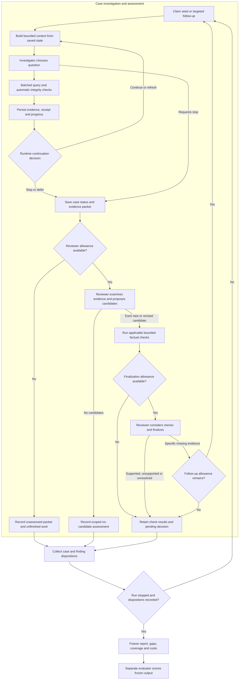

# Proposal: evidence-backed AML graph investigation

Revision 2, 23 October 2026. Design only; no implementation or new model experiment. This revision incorporates the user-supplied goal/experiment review and the subsequent clarification of agent roles. The earlier two full reviews assessed revision 1; they have not reviewed this revision. [Revision decisions](REVISION-2-DECISIONS.md)

## 1. Goal and responsibilities

Build a prototype that explores IBM transaction networks, assembles traceable evidence, identifies suspicious transactions/chains, and records what remains unexplored. Evaluate both whether adaptive navigation helps investigation and whether the complete system adds value over a non-LLM detector.

**The investigator gathers evidence; the reviewer proposes and decides candidates.** The investigator can record leads and hypotheses to guide exploration, but those notes are not predictions. The reviewer examines the evidence, proposes structured candidate claims, receives deterministic check results and finalizes or requests targeted investigation. The same logical reviewer can perform the proposal and finalization passes; another agent identity is not required for each pass.

| Component | Owns |
|---|---|
| Scheduler/runtime | Seed manifest, case/work states, resource admission, persistence, hard stops and run closure |
| Investigator agent | Next investigative question, permitted batched queries, leads, alternatives and evidence packets |
| Query service | Bounded label-free retrieval, aggregation, pagination, receipts and result integrity |
| Case/evidence store | Immutable references, progress, pending actions, packet/candidate revisions and decisions |
| Reviewer agent | Candidate discovery, typed claims, interpretation, follow-up requests and final disposition |
| Deterministic verifier | Checkable factual assertions; never a laundering verdict |
| Evaluator | Hidden labels/patterns, frozen predictions and comparative metrics |

Start with one investigator, one reviewer and a durable store. Markovian and branch workers are later optional comparisons. No particular framework or database is required. Domain sources are IBM data and AUSTRAC indicators; an earlier user-provided brainstorming document and its rule list were deliberately excluded as unverified design inputs.

## 2. Flowchart and termination

The scheduler repeats the case process over selected work. The final report is assembled at run closure; intermediate arrows persist records rather than immediately publish a final report. Every admitted packet/candidate must have an explicit disposition, including unassessed, unchecked or awaiting finalization when resources expire. Reporting itself uses stored records and does not require another unbudgeted model call.

A case with no investigator lead still goes to the reviewer when assessment is scheduled: the reviewer may discover a candidate independently. Only the reviewer can record a scoped no-candidate assessment. An unassessed packet cannot become a negative result.

The runtime owns hard continuation decisions. The investigator may request stop, but cannot exceed data/time/resource limits. A proposed initial no-progress rule defers after three consecutive completed actions produce no new evidence, completed pending item, explicit question resolution or candidate revision. This is an engineering default to test and freeze; a legitimate negative query can count as resolving a documented question. The runtime records the reason and prevents repeated identical requests from resetting the counter.

Case states are queued, active, paused and closed-with-reason. Reviewer follow-up on a closed case is an explicit, logged `reopen_for_followup` transition with an approved work item and remaining allowance. Candidate states are independent. Only new or changed candidate revisions re-enter verification; unchanged decisions remain reusable. Existing supported findings do not close other branches.

## 3. Data scope, indicators and starting points

A run contract pins the source hash, reporting interval `[S,T)`, historical interval `[H,S)`, **data-availability cutoff** `T`, frozen indicators/operational rules, tools, model settings, seed manifest and budgets. No evidence at or after `T` is available. This cutoff is unrelated to a model's training cutoff. Timestamps retain source minute precision and unspecified timezone.

HI-Small is development material. The initial proposed seven-day development window is `[2022-09-04 00:00, 2022-09-11 00:00)`, with historical support `[2022-09-01 00:00, 2022-09-04 00:00)`. This is not a fresh holdout: earlier probes and profiling used HI-Small. Shorter development windows may be used for mechanics tests and must be recorded.

Exclude HI-Small records at or after 11 September from ordinary development/detection reporting and operational seed selection. Retain them only in a separately named artifact/episode-completion diagnostic. The tail has 655 positive labels among 1,108 rows (59.12%), versus 4,522 among 5,077,237 primary-period rows (0.08906%). A date shortcut exploiting that distribution is not evidence of general AML capability. [Data audit](../../research/ibm-data-and-evaluation.md)

For subsequent confirmatory seven-day comparisons, use the primary-period HI-Large data (1 August–5 November), after documenting prior exposure and reserving explicit development/validation/test boundaries. Large provides a longer horizon; LI-Small also has only ten primary days and would not solve the duration constraint. Existing HI-Large connectivity profiling is disclosed. Exact held-out dates must be locked before inspecting their outcomes, not invented as already untouched. Download/validate Large account metadata before any entity-based claim; it is not currently part of the Large transaction audit.

Maintain a versioned mapping from AUSTRAC indicators to observable fields and operational conditions. Thresholds and windows are development choices, not automatically regulatory requirements. Every candidate cites an indicator/operational-rule version or is explicitly tagged an exploratory hypothesis without a validated mapping. An unmapped exploratory lead is reported separately from rule-supported findings.

A seed is a starting transaction or account/time unit; a random-number seed separately reproduces sampling. Use arbitrary seeds for mechanics only. Detection pilots compare label-free priority seeds from frozen rules/statistics with a documented exploratory sample outside those hits. Selection cannot use hidden labels or reference-pattern membership. Record quotas, sample weights, duplicates and inclusion probabilities where known. Uniform transaction sampling emphasizes busy accounts and is not equivalent to uniform account sampling.

A pilot estimates positive-seed prevalence, positive evidence reached within allowed queries, distinct episode/case support, false-alert burden and cost. Fifty uniform primary-period transaction seeds have only about 0.045 positive seeds in expectation; this does not predict investigation yield, because benign seeds may reach positive neighbors. Choose comparative sample sizes using pilot yield and variability, not prevalence alone. An underpowered pilot is a mechanics/cost result, not proof of no value.

## 4. Tools and evidence boundaries

These are application contracts, not library APIs.

| Tool | Output and boundary |
|---|---|
| `summarize_activity` | Batched counts, counterparties, time ranges and per-currency totals; exact scope, completeness and reproducible drill-down reference |
| `fetch_transactions` | Exact IDs or bounded account/time/direction results; stable pagination and both monetary sides |
| `expand_frontier` | Several branches in one operation; bounded work/output and explicit remaining pages |
| `record_progress` | Versioned questions, resolved scope, hypotheses and pending actions; cannot rewrite receipts |
| `submit_evidence_packet` | Immutable packet revision with exact references, coverage, contrary observations and unresolved work |
| `record_candidate` | Reviewer-owned typed claims, implicated IDs, separate support IDs, indicator mapping and interpretation |
| `verify_claims` | Valid/invalid/not-checkable results for a particular candidate revision, with reasons and computed values |

The backend automatically saves successful receipts before presenting results; evidence persistence never depends on the model remembering a save call. Integrity checks on retrieval include source IDs, types and allowed scope. Runtime roles receive only authorized tools and data views, not general access to the research archive containing labels and answers. Error messages and auxiliary outputs must respect that boundary too.

Every query bounds both computation and returned context: time/account scope, deadlines, work limits where available, page size and output bytes/tokens. A SQL `LIMIT` does not bound a costly join. When a hub exceeds the retrieval allowance, return a scoped summary/count if available and explicit paging options. If the degree/count is unknown, say so; do not incur an unbounded count merely to produce metadata. Freeze this behavior for both experimental arms.

Pagination orders by `(timestamp, original source-row ID)` or an equivalent stable total order. Cursors bind to source version and canonical parameters. The row tie-breaker is not causal chronology. Batched expansion uses a deterministic union order or separate branch cursors. Retain equal-time, self, parallel and duplicate-looking source rows; changed filters require a new cursor.

An evidence packet is not the whole case or graph. A model working view may contain 500–1,000 rows while the durable case contains much more. Candidate checks use the exact IDs or complete query scope required by each claim, not an arbitrary first 100/500 rows. No exhaustive motif enumeration is implied.

## 5. Typed claims and the support rubric

Free text describes interpretation; structured fields make factual verification possible. The first prototype needs two claim kinds:

| Kind | Required fields and checks |
|---|---|
| `path` | Ordered transaction IDs; declared strict or non-decreasing time rule; optional cycle, elapsed-time bound; check source existence, connected endpoints, ordering, closure and duration |
| `aggregate` | Immutable query/scope reference, grouping, function, amount side/currency, asserted value and optional threshold/operator; recompute with declared completeness |

Temporal bursts can initially be aggregates over time/count scopes. Add `recorded_entity_relation` only when source metadata is available and the experiment needs it; this establishes a recorded relation, not beneficial ownership. Unknown claim kinds remain unsupported by the checker rather than being guessed from prose.

Money uses exact decimals. Incoming amounts use the received side and outgoing amounts the paid side. Report aggregates separately by currency. The initial prototype does not derive general FX conversion rates from paid/received pairs or reconcile a mixed-currency chain as conserved funds. Preserve both sides for observation; cross-currency connectivity can still be checked.

“Supported candidate for further review” requires:

1. Required factual claims pass applicable checks on the current revision; failed or unavailable required checks cannot be silently approved.
2. The observable conditions of the cited operational indicator are met. Missing customer-purpose/KYC prerequisites are explicitly unavailable rather than assumed true.
3. Material contrary evidence and plausible alternatives are considered, with unresolved alternatives stated. Ruling out every legitimate explanation is not required for suspicion.
4. Query completeness is sufficient for the claim. An absence/whole-period total requires complete relevant scope; a witnessed three-edge cycle does not require the entire surrounding graph.
5. The reviewer identifies precisely which transactions are implicated, and separates them from contextual evidence.

A narrower factual claim may be supported after a failed broader claim, but must be an explicit new revision. Exploratory hypotheses without sufficient operational mapping remain provisional and outside the primary supported prediction set. Model confidence percentages are not calibrated probabilities.

Cheap integrity checks are separate from query-based checks that may be expensive. Run admitted verification using its reserved code/query allowance independently of remaining LLM-review allowance. If verification cannot finish, store `not_checkable` with a budget/incompleteness reason. A lack of reviewer tokens does not erase available factual check results, and deterministic code is not exempt from resource limits.

## 6. Durable state and coverage

Store run contract and seed manifest; cases; immutable packets; query receipts; exact evidence references; pending actions; candidate revisions; and version-specific checks/decisions. Original source hash plus original data-row ordinal identifies a transaction; composite bank/account keys identify accounts. Summaries orient the next context but do not replace evidence.

Receipts retain canonical query parameters, order, returned IDs or immutable aggregate result, completeness, cursor, outcome and usage. With one case writer, use idempotent action IDs and expected revisions. Save receipt and mechanical pagination/progress changes atomically; later model interpretations are separate validated updates. After interruption, reconcile in-flight actions and reuse saved results. Unknown consumed resources remain unknown/reserved, not reset to zero.

Define reporting population `P` as unique eligible original row IDs in `[S,T)`. Report unique reporting rows retrieved, presented and included in an agent-recorded assessment separately, each over `|P|`. Separate investigator and reviewer activity, and report their union without double-counting. Reviewer tool retrieval and prompt evidence count under the same definitions. Historical support is separate from `P`.

Presented means explicitly included as rows in a model request; an aggregate scanning 10,000 records does not mark those rows presented or assessed. Recorded assessment is a model assertion of scoped work, not proof of comprehension. Report reviewed implicated and contextual IDs separately. Overlapping cases count a row once in run-level sets. These measures do not establish exhaustive path or episode coverage.

Track seed-manifest states independently from discovered work items. An account is not globally “visited”: incoming Monday activity can be complete while outgoing Tuesday activity remains partial. Pending actions retain question, account/time/direction/filter scope, evidence, cursor and reason. Emptying a seed queue does not mean examining every graph path. Unknown/unassessed regions are not benign.

Cache only queries equivalent in source, scope and semantics. Sharing an account does not merge cases; exact repeated claims can be deduplicated and related cases linked. Reuse of an assessment additionally depends on question/rule versions.

## 7. Context, reviewer stages and follow-up

Build every request from governing rules/scope, current question, selected exact evidence, relevant pending actions, previous validated observations and recent tool messages. Enforce complete-request tokens plus generation reserve. The earlier 120k combined budget/70k evidence allocation is a planning example, not a proven model-quality limit. [Measurements](../../experiments/2026-10-23-context-budget/README.md)

Persist evidence and unfinished path endpoints before refresh. Evicting rows from the prompt does not delete them or finish their questions. Large evidence packets are reviewed through bounded views with stable cross-view evidence references. Freeze ordering, selection, compaction and cross-view synthesis policy for comparative runs; fixed expansion must not receive a worse context policy by accident.

Reviewer stages are proposal and finalization, not two guaranteed-independent judgments. To reduce anchoring, initially show question, evidence, scope and contrary observations without the investigator's persuasive suspicion narrative; store that narrative for audit or later explicit access. The reviewer records its own candidates before receiving factual check outcomes. It can make bounded drill-down queries; new discoveries are new candidate IDs, not silent changes to another finding.

Outcomes: supported, unsupported, needs evidence, unresolved. A reviewer request specifies a missing fact, bounded query scope, related candidate revision and allowance. Follow-up reopens or resumes the case explicitly. New evidence increments affected packet/candidate revisions; only new/changed claims are rechecked/reassessed. An unchanged supported finding is not rerun merely because another branch needed work.

Reserve investigation, factual verification, reviewer/finalization and follow-up shares within a total case/run allowance. All calls, retries, compaction and optional workers count. Freeze maximum follow-up rounds and no-progress policy before execution. When allowance expires, preserve unassessed packets, unchecked claims or pending decisions distinctly. A runtime stop does not generate a negative assessment.

## 8. Worked case

Illustrative records, not an additional IBM result:

1. Seed T10 is A→B. One query retrieves B's outgoing activity and its exact scope; T20 is B→C. Another query summarizes C's activity and returns a partially retrieved page.
2. The investigator approaches its context limit. It saves T10/T20, the page cursor and “complete C's outgoing query” as pending work. The next context resumes the same case.
3. The completed query includes T30, C→A. The investigator submits a packet with all three rows, surrounding observations and query completeness. It does not issue a final suspicious label.
4. The reviewer proposes a `path` candidate on T10/T20/T30 with strict chronological order, cycle=true and an asserted duration. Code checks these against source rows. An equal-time ambiguity would fail a strict-order claim; a mismatched endpoint would invalidate closure.
5. The reviewer decides whether the verified structure meets the cited observable indicator, considering contrary evidence and missing purpose information. It can support a candidate with limitations, reject it, or request specific additional evidence.
6. A follow-up changing the claim creates a new revision. The final report includes its current disposition and any unfinished surrounding exploration; unrelated earlier findings remain unchanged.

## 9. Experiments: three different questions

| Stage | Question and comparison | Permitted conclusion |
|---|---|---|
| Mechanics | Arbitrary recorded development seeds plus semantic fixtures; run one case through refresh, persistence, reviewer and follow-up | Whether the execution contract works |
| Navigation | Same frozen seed alerts/evidence access; fixed expansion versus adaptive investigation; same reviewer, verification and context policy | Whether adaptive navigation adds value under these settings |
| Complete system | Frozen non-LLM rule detector with deterministic expansion/flagging versus complete agentic pipeline on the same eligible population | Whether the full pipeline improves the declared cost-quality objective |

The deterministic detector must have an explicit mapping from rule hits to implicated IDs, overlap handling and tuned-on-development thresholds. Do not flag every neighboring support row. Use indicator-derived label-free seeds for the primary navigation comparison; evaluate an exploratory/mixed-seed stratum separately. A broader learned statistical baseline can be added later but is not required for mechanics.

Freeze fixed expansion direction, windows, depth, branch/row ordering, truncation, pagination and stopping, plus how oversized results are presented and combined. Adaptive tool defaults and completeness metadata are identical. The conclusion concerns that declared baseline, not all deterministic algorithms. If end-to-end arms change both seeds and investigation, attribute results to the whole pipeline; navigation attribution comes from the same-seed experiment.

Pilot stochastic settings with at least three repetitions per seed set/configuration as an initial development default; this is not a power guarantee. Use pilot variance, independent case/episode support and a meaningful target difference to set confirmatory sample size and repetition count before test execution. Pair comparisons on the same seed manifest. Report dispersion, failure rates and actual costs. Repeated model runs measure execution variability, not new independent episodes.

Estimate uncertainty using predeclared time blocks or case groups that account for overlapping evidence/known episodes; naive transaction-wise or overlapping-case bootstrap is inappropriate. Pattern annotations cover only part of labeled activity, so disclose limits on episode grouping. If there are too few independent groups, report uncertainty as insufficient instead of manufacturing a narrow interval.

Cache each experimental arm/run separately with an identical cold or predeclared warm policy. Do not let one arm populate the other's cache. Record actual model tokens, tool/database work, rows, time and cost, with infrastructure conditions. Equal ceilings control opportunity; cost-quality curves at several development budget settings reveal actual efficiency. Fix confirmatory budget settings before looking at test outcomes.

## 10. Predictions, success criteria and reporting

Freeze reviewer initial-proposal predictions before factual-check feedback or requested re-investigation: unique implicated reporting IDs in first-pass candidates from the initial evidence packets. This replaces revision 1's investigator prediction snapshot. Freeze final predictions as unique implicated IDs in current supported candidates after verification/follow-up. Keep exploratory, unsupported, unresolved and unreviewed sets separate. Attribute changes and extra cost to the full verification/finalization/follow-up stage, not independent reviewer skill.

Report transaction precision/recall using all positive labels in the declared reporting population as the recall denominator, including positives never reached. Also report conditional seed-region recovery, observed chain validity, eligible annotated-pattern recovery, duplicate alerts and workload. Reference patterns are incomplete; their absence is not a negative label or exhaustive chain ground truth. Use reproducible unflagged-region audits for failure analysis, not as a substitute for population metrics.

Before confirmatory evaluation, register the primary objective: **increase transaction recall at a fixed false-positive/review allowance and total-cost ceiling**, with a minimum meaningful improvement and an uncertainty decision rule. Numerical allowances, minimum improvement, case/transaction workload unit, repetition count, dates and model/backend must be chosen from development needs and locked in the run manifest. Reject a confirmatory launch with missing values. They are not invented as validated product requirements in this proposal.

Exploratory development may measure yield/cost before those final thresholds are chosen, but cannot be called a successful confirmatory comparison. Random transaction-row splits can share episode evidence across development/test. Declare temporal boundaries, permitted historical context and known episode overlap. Unseen-entity/episode generalization is a separate claim requiring its own split design.

At run closure, freeze candidates, versions, decisions and coverage before the evaluator reads predictions against hidden labels. Produce supported findings with cited indicators, implicated IDs/chains, contextual evidence, check results, alternatives and limitations; separately report rejected, unresolved and provisional work. Include all seed/work statuses, coverage counts, resource use and why work stopped. Candidate review does not measure everything missed.

## 11. Delivery gates and limits

1. **Data and tools:** pinned label-free access, exact IDs/decimals, stable multi-page retrieval, scope enforcement and immutable receipts.
2. **One complete case:** investigator packet → reviewer candidate → typed checks → final decision/follow-up; cross-context and restart recovery.
3. **Mechanics acceptance:** test no-candidate and unassessed packets, mixed valid/invalid candidates, equal-time/parallel rows, incomplete aggregates, incompatible currencies, overlapping coverage, a new reviewer discovery, stale approval after revision, exhausted verification/review budgets and bounded re-opening.
4. **Development experiment:** freeze a non-LLM baseline and same-seed navigation comparison; measure yield, repeated-run variation and actual cost without claiming held-out success.
5. **Confirmatory gate:** complete the locked manifest above, justify sample size, isolate evaluation data and execute the predeclared comparison. Detection value precedes wider deployment or framework expansion.

Limitations: IBM is synthetic; indicators can require unavailable customer context; matching a shape does not establish the same funds or criminal purpose; a fresh reviewer can share investigator/model biases; context capacity is not accuracy; bounded exploration can miss episodes. These limitations must remain visible in reports without requiring every hypothesis to rule out all legitimate activity.

Baseline implementation uses an ordinary tool loop and durable state. Meterless Markovian is an optional continuation adapter, not SQL execution, a transaction cap or crash recovery. Branch workers are optional later comparisons under the same aggregate budget. [Framework findings](../../research/adaptive-graph-framework-review.md)

## Sources and revision history

- [Data/evaluation research](../../research/ibm-data-and-evaluation.md), [indicator and graph semantics](../../research/indicators-rules-and-investigation.md), [adaptive investigation research](../../research/adaptive-graph-investigation.md).
- Original drafting inputs: [flow](contributions/flow.md), [state/tools](contributions/state-and-tools.md), [verification/evaluation](contributions/verification-and-evaluation.md).
- Earlier full reviews: [correctness](reviews/correctness.md), [effectiveness](reviews/effectiveness.md); [revision 1 resolutions](REVIEW-RESOLUTIONS.md).
- [User-supplied review](reviews/goal-and-experiment.md) and [revision 2 decisions](REVISION-2-DECISIONS.md). Historical contributions/reviews describe earlier role ordering and are not the current execution contract.
