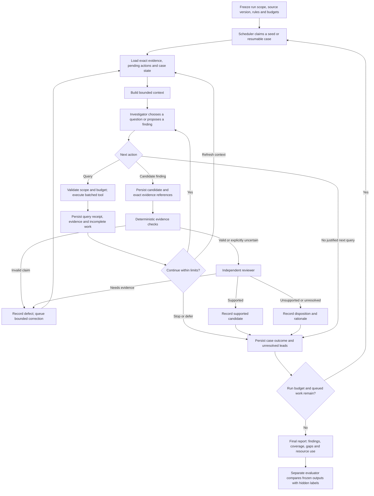

# Draft contribution: investigation flow and lifecycle

This is a proposed design, not an implemented detector or a validated accuracy claim. Existing measurements support packet sizing; they do not establish that 1,000 rows are a reliable reasoning limit. Original excluded proposal documents were not used.

## Core flow

Diagram arrows that return to investigation are conditional on remaining case/run budgets and an allowed rework count. An exhausted case is deferred, not silently reopened by review. Budget control also covers reviewer calls and reporting. Reserve enough for structured closure even when investigation runs out of resources.

Review can run as candidates are submitted or after the investigation phase. In either schedule, the final report waits for every candidate to have a recorded review disposition or an explicit unreviewed status. A supported finding does not close all other pending branches of its case.

## State model

Use separate states for cases, work items and findings. One case can have supported findings and unfinished work simultaneously.

- **Case lifecycle:** queued → active → paused/resumable or closed. Closure reason: declared scope completed, no justified next action, budget exhausted, cancelled or execution failure. “Closed” never means every connected transaction was examined.
- **Work item:** pending → claimed → completed, partial, deferred or failed. It stores its account/time/direction/filter scope, pagination position, purpose and supporting evidence references. Partial work produces a continuation item; retryable failure does not erase the work.
- **Finding:** proposed → factual checks → review → supported, unsupported, needs evidence or unresolved. A revision preserves the previous finding and review, rather than overwriting its history.
- **Evidence coverage:** returned, assessed, and query-complete are distinct properties. Store what was assessed for which question and case; an account-level visited flag is insufficient.

Scheduler ownership is ordinary application state, not an LLM's recollection. A claimed item needs a resumable lease or equivalent recovery policy. A result is committed with its receipt before it is treated as completed. Replays reuse stable IDs to avoid duplicate candidate creation or losing unfinished pages.

## Essential invariants

1. Every finding cites versioned transaction IDs; exact source rows remain retrievable across compaction. Summaries never replace primary evidence.
2. Every successful query produces a receipt with scope, result IDs, ordering and completeness/truncation status. Unknown completeness stays unknown.
3. Trimming a prompt changes the working view only; it cannot delete evidence, finish a pending action or label a region benign.
4. A context refresh preserves case ID, frozen rules, knowledge cutoff, unresolved questions and pending action references. It is continuation of the same case, even with a new model conversation.
5. Query execution and model generation both obey per-call, case and run bounds. Tool output is sized before prompt insertion; overflow is persisted and paged.
6. Same-account overlap does not imply duplicate cases. Duplicate evidence can be shared; findings are reconciled using their claim and evidence, with the decision recorded.
7. Reviewer requests consume shared resources and a bounded rework allowance. No-progress and repeated-query handling can defer a case; they must not fabricate a negative classification.
8. The reviewer sees exact evidence, factual check results, scope limitations and alternative explanations. Its agreement is a review outcome, not proof of criminality or model independence.
9. Runtime agents cannot access IBM labels/pattern answer files. Final evaluation uses a frozen output snapshot and separate access.
10. Population coverage remains a scheduler/evaluator responsibility. Reviewing proposed findings alone cannot measure missed cases.

## Smallest useful prototype

One investigator, one separate reviewer, one local query backend, one durable case store and deterministic scheduler. Do not start with nested investigation workers or Markovian integration. Tools: activity summary, bounded transaction fetch/expansion, evidence verification, state update and finding submission. A general path enumeration tool can wait.

Use a fixed development seed list and fixed reporting/history windows. Run fixed expansion and adaptive navigation against the same seeds, permissions and aggregate resource limits; keep reviewer policy equal too. Start with a working-view target around 1,000 rows while enforcing complete-request tokens, not a row cap alone. Exact operating budgets are explicit experiment parameters to select before running.

Mechanics acceptance checks:

- A chain crossing a context refresh is reconstructed using the same transaction IDs.
- A partial paginated query remains partial after resume and is eventually continued or explicitly deferred.
- Restart after a saved tool result does not lose evidence or duplicate a finding.
- Reviewer requests for additional evidence terminate when their allowance expires.
- Final output distinguishes proposed, supported, rejected and unreviewed findings, plus outstanding work.
- Scope/time/currency violations are rejected or represented as uncertainty rather than silently accepted.

These checks validate execution mechanics. Detection usefulness still requires held-out evaluation and explicit recall denominators, including positives never reached by an investigator.

## Basis

- [Existing adaptive investigation design](../../../research/adaptive-graph-investigation.md)
- [Project handoff and verified status](../../../HANDOFF.md)

