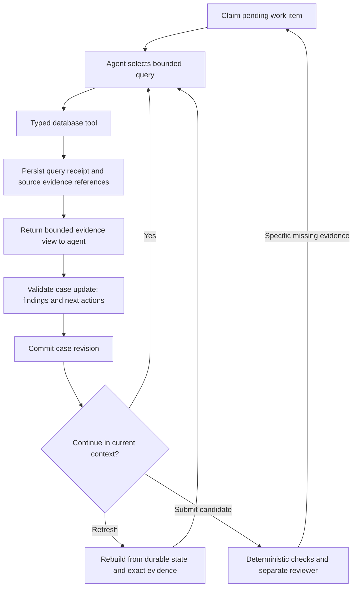

# Contribution: durable state, evidence and tools

Design proposal, 23 October 2026. This is an application design, not implemented functionality. It uses the existing [adaptive investigation research](../../../research/adaptive-graph-investigation.md) and [IBM data audit](../../../research/ibm-data-and-evaluation.md). Original proposal documents and their rule list are excluded.

## Recommended core

Use one versioned source dataset and a small durable case store. The agent chooses questions and records interpretations; backend tools persist query receipts and evidence references automatically. Do not depend on the model remembering to save everything or on a narrative summary preserving unfinished work.

Evidence, an observation about evidence, and an AML interpretation are distinct. An exact cycle can be verified; a claim that it represents laundering cannot be established from connectivity alone. The stored finding must keep those statements separate.

## Minimal durable contracts

These are conceptual record shapes, not final database tables or SDK APIs.

| Record | Essential contents |
|---|---|
| Run | Dataset identity/checksum; scored window; permitted evidence window and cutoff; frozen rule/prompt/tool/model versions; total budget and usage |
| Case | Stable ID; seed and selection reason; run ID; revision; status; orientation note; linked findings and work items |
| Evidence reference | Transaction ID derived from file checksum and original row ordinal; raw source locator; normalized endpoints and typed fields; optional query/result reference |
| Query receipt | Request ID; tool/version and normalized arguments; dataset/cutoff; deterministic ordering; returned IDs or immutable result reference; completeness and truncation reason; next cursor; resource use |
| Work item | Case ID; question; account/time/direction/filter scope; query/cursor if available; supporting evidence IDs; status; worker lease; result reference |
| Finding | Claim version; flagged transaction IDs; separately listed contextual IDs; ordered edge IDs for chains or explicit subgraph structure; observable facts; guideline reference; interpretation; alternatives; limitations; verification/review status |

An aggregate receipt must retain its scope, grouping, units, result and reproducible query. It need not list millions of input IDs in the prompt or duplicate the entire source file. Detailed source evidence must remain retrievable for verification. A replay after a timeout must not silently treat an incomplete result as complete.

Run scope is authoritative and checked by every backend tool. Agent arguments may narrow it, never broaden it. Labels, pattern answers and evaluator feedback are inaccessible to investigation and reviewer agents. Label filtering is enforced in data access, including metadata/results/error messages, rather than only described in a prompt.

## Practical initial tool surface

| Tool | Purpose and required boundaries |
|---|---|
| `summarize_activity` | Batch account/time/direction statistics; per-currency totals; exact or explicitly partial scope; stable drill-down query reference |
| `fetch_transactions` | Fetch by IDs or bounded account/time scope; stable ordering and pagination; preserve both paid and received amount/currency pairs |
| `record_case_update` | Save a versioned finding, assessed evidence scope, alternative explanation or explicit next work item; validate referenced IDs and expected case revision |
| `verify_evidence` | Recompute a claimed chain, connectivity, chronology or per-currency aggregate from source references; output check results and limitations |

The runtime persists query receipts and claims work items; those responsibilities need not be additional model tools. Add bounded `trace_paths` only when its value is demonstrated. Repeated general retrieval can support the first prototype without a large motif-specific API. Free-form SQL is unnecessary initially.

All query tools constrain both computation and output: account-set size, evidence interval, query deadline/work allowance, output bytes/tokens and page size. A row limit alone does not bound an expensive join. When a result exceeds budget, return a compact summary and explicit continuation/deferred work; never silently discard rows. Distinguish exact full-scope summaries from sampled or partially computed summaries.

## Navigation and coverage

Track the scope of a question, not a global `visited_account` Boolean. A scope includes dataset, accounts, interval, direction, filters, grouping or path constraints, and cutoff. For example, outgoing activity on Tuesday can remain pending even if incoming activity on Monday has been assessed.

Keep distinct events/states:

- **Scheduled:** a question has been queued.
- **Retrieved:** a tool returned a defined result; completeness is independently recorded.
- **Presented:** specific evidence IDs or an aggregate were included in a model request.
- **Assessment recorded:** a model returned an assessment explicitly scoped to that evidence; this records a claim of assessment, not a guarantee of comprehension.
- **Deferred/incomplete:** cursor, branch or unresolved question remains, with reason.
- **Closed:** the work item's declared question is answered, rejected as unsupported, or stopped with a recorded limitation. Closure does not certify the account or neighborhood as benign.

Do not derive population detection coverage from retrieved row counts. Report separately: seeds/regions scheduled, exact rows retrieved/presented, recorded assessments, complete query scopes, and unresolved work. Summary-based exploration is useful but is not equivalent to inspecting every underlying transaction. A case may stop with a valid candidate and still have unexplored branches.

## Overlap, recovery and context refresh

Overlapping cases share stable source IDs. Cache only requests equivalent in dataset, cutoff, filters and tool semantics. Query-result reuse saves database work; prior assessment reuse additionally needs compatible rule and question versions. Two cases touching one account are not necessarily duplicate episodes. Exact duplicate finding versions can be detected from normalized flagged evidence plus claim/rule identity; related findings should be linked for review rather than prematurely merged.

Use leased work claims and idempotent request/update IDs. A successful query receipt is durable before being shown to the model. Case updates use an expected revision to avoid overwriting another worker's work. On interruption, replay the saved result if present; otherwise rerun the read-only operation under the same immutable dataset and record its resource usage. Reconciliation must account for work that ran before a crash even if provider billing/usage is temporarily unknown.

Context refresh reloads the governing instructions, current hypothesis and limitations, selected exact evidence, and the next work item from durable state. Prompt eviction removes a displayed copy only; it does not delete evidence or close a branch. Persist the pending query/cursor before refresh. Budget exhaustion produces `deferred_budget`, not a negative classification. Repeated identical queries or repeated updates without new evidence trigger a bounded no-progress stop.

## Reviewer input and authority

Submit an immutable finding revision and an evidence bundle: flagged/context IDs, exact relevant rows, claimed chain/subgraph, query receipts, declared scope, deterministic checks, alternatives and unresolved questions. A fresh reviewer may drill down through the same label-free tools within its reserved budget. Its result cites evidence and targets that exact finding revision.

Reviewer outcomes are supported-for-review, additional-evidence-needed, unsupported, or unresolved-within-budget. A request for more evidence creates a scoped work item; it does not restart the case unboundedly. Preserve earlier candidate and review revisions. Never overwrite a rejected interpretation with a supported status without recording the changed evidence and a new review. Review is quality control over proposed findings and does not establish recall over unflagged data.

## IBM-specific invariants

- Account key is canonical bank ID plus account number; account number alone is insufficient. Preserve raw values and the validated normalization mapping.
- Transaction IDs identify original row instances. Preserve parallel transactions, self-transfers and exact repeated rows; do not collapse these automatically.
- Money retains exact decimal values and currency. Paid and received amounts/currencies are separate; incompatible currencies cannot be summed as one amount.
- Minute-resolution timestamps do not determine order between equal-time edges. A source row ordinal is a stable pagination tie-breaker, not evidence of chronology. No timezone is invented.
- Account-to-entity links mean the recorded metadata relation only. Do not infer control chains, economic purpose or countries from names.
- Every query obeys the permitted evidence interval and knowledge cutoff; reporting targets are restricted separately to the scored window.

## Proposal acceptance checks

The prototype should demonstrate: continuation of a chain across a context refresh; recovery after query completion but before case update; an incomplete page remaining pending; no duplicate work-item execution causing duplicate findings; source verification rejecting a fabricated ID; equal-time and currency ambiguity preserved; and cross-branch evidence reunited before review. These establish state/tool mechanics. Detection quality requires the separate held-out evaluation.
