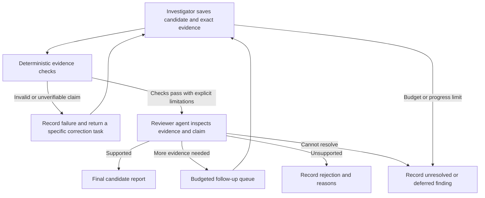

# Candidate verification and evaluation — draft contribution

Design proposal, 23 October 2026. No implementation or new inference. Based on the existing adaptive-investigation research and context-budget measurements; the excluded original proposal is not a source.

## Record candidates during investigation

The investigator should save a candidate as soon as useful evidence exists, then revise it as evidence changes. A candidate is a versioned claim, not a positive label or final accusation. Store:

- Stable case and finding IDs, dataset version and reporting interval.
- Explicitly flagged transaction IDs, separately from contextual/supporting transaction IDs.
- Ordered paths or branching edge sets where relevant; retain original source row identity and source retrieval references.
- The observed facts, proposed interpretation, applicable guideline/version, contrary evidence and unresolved questions.
- Query receipts establishing evidence scope, truncation, pagination and permitted cutoff.
- Status, revision and review outcome. Use a categorical assessment initially; uncalibrated model percentages are not probabilities of laundering.

Evidence should survive context refreshes and rejected findings. Identical evidence may support different claims; sharing an account alone does not justify merging two findings. Deduplicate exact repeated findings, link materially related cases, and count unique transaction IDs in evaluation.

## Verification pipeline

The deterministic checker validates source identities, existence, edge endpoints, chronological constraints, arithmetic, currencies and claim scope. A sequence of transfers does not establish identity of the underlying funds. Equal-minute timestamps do not establish an ordering within that minute. A currency conversion needs an explicit source basis; amounts in incompatible currencies must not be silently added. Failing a check may require correcting the claim rather than discarding every underlying observation.

The reviewer gets the candidate, exact evidence, scope and query receipts in a fresh bounded context. It checks whether the interpretation is supported, examines contrary evidence and plausible alternatives, and can request narrowly scoped follow-up retrieval. It must have access to raw evidence rather than only an investigator-written summary. Fresh context separates responsibilities but does not make its errors statistically independent of the investigator's errors.

Both roles remain label-blind. The evaluator alone can access IBM labels/pattern files after predictions are frozen. Review findings incrementally when useful; every candidate included in the final supported list must have a recorded review of its current revision. Changed evidence invalidates earlier approval of that claim until reviewed again.

A follow-up task contains the specific missing fact, account/time/query scope, evidence IDs and a remaining budget. Repeated requests without new evidence must terminate or defer under explicit no-progress and total-case limits. Reserve capacity for verification when admitting an investigation; discovery should not silently consume the entire run budget and leave purported final findings unreviewed.

## Final deliverable

Report supported suspicious candidates with their transaction chains, source evidence, observation/interpretation distinction, review result and limitations. Also disclose unresolved findings, deferred tasks and what was not examined. A run finishing or exhausting its budget does not establish complete coverage or classify its remainder as benign. The output is evidence for review, not proof of criminal intent.

## Fair comparison

First compare fixed expansion with adaptive single-agent navigation. Freeze the same dataset snapshot, reproducible seed list, permitted reporting/history windows, knowledge cutoff, tool capabilities, model settings and overall resource caps. Fixed expansion uses predetermined retrieval choices; both arms receive the same assessment and review stages so the comparison isolates navigation. Log actual usage as well as maximum allowances.

A seed means a starting transaction or account/time region, not a random-number seed. Record the random-number seed separately when sampling starting points. Budget comprises complete-request context/output limits and total run/case resources: model tokens, calls, query work/time and returned evidence. A 1,000-row working view is not a lifetime case allowance. Include reviewer, follow-up and optional worker usage in the total. Use the same total resource allowance for parallel and single-agent variants.

Change one factor at a time: navigation first, continuation policy second, delegation third. Evaluate seed selection separately by comparing reproducible exploratory sampling with inexpensive indicator-prioritized seeds and a declared mixture. Uniform transaction sampling weights high-activity accounts more heavily; account/time sampling has a different population. Choose and report the target population rather than calling either unbiased in all senses.

The prior two-case probe is development evidence, not an unseen test. Freeze a fresh held-out evaluation and prevent label-derived seeds, reference patterns and known positive case identities from reaching the investigator. A chronological split needs an explicit knowledge cutoff and episode-boundary policy; a transaction-row split can leak connected episode evidence. Separate deliberate positive-enriched diagnostic cases from population estimates.

## Measurements

Keep three questions distinct:

1. **Mechanics:** Can the system preserve and verify evidence, resume work, enforce budgets and report incompleteness correctly?
2. **Conditional investigation quality:** Given a particular seed and permitted neighborhood, what relevant evidence does it recover, flag or miss?
3. **Population discovery:** Under the declared seed policy and total budget, how many positives across the eligible population are actually found?

Report unique flagged-transaction precision and recall against hidden labels, false-positive/review burden, chain validity, incomplete-case rate, repeated work, actual token/query costs and elapsed time. Include investigator outputs before review and final outputs after review to detect whether verification trades away recall. For a bounded pilot, label any sample-based estimates and uncertainty; conditional recall must not be presented as population recall.

Reviewing candidates alone cannot expose missed detections. Score all eligible labeled positives against the frozen output, where the evaluation population is fully defined, and inspect a reproducible sample of unflagged regions for failure analysis. IBM pattern files are only partial episode annotations: do not use them as an exhaustive ground truth of every laundering chain. Transaction-label performance and pattern recovery are separate metrics. Supporting benign transfers must not automatically count as flagged illicit transfers.

## Minimum prototype acceptance criteria

These are proposed mechanics gates; detection-quality targets must be declared before held-out testing, not chosen after seeing results.

- Every final supported finding resolves to exact versioned source transactions and passes its applicable deterministic checks; unresolved/failed checks remain visible.
- A fixture whose relevant chain spans a context refresh is reconstructed from retained IDs and pending work without losing evidence or fabricating edges.
- Incomplete pagination, equal-time ambiguity and incompatible currencies produce explicit limitations, not complete-neighborhood or unsupported arithmetic claims.
- A high-degree hub and a repeated no-progress query terminate/defer within enforced case/run limits; restart retains unfinished work and does not duplicate a final finding.
- A reviewer can reject an unsupported claim and request a targeted follow-up, and both paths appear in the durable audit record.
- Runtime investigator/reviewer data access excludes labels and pattern answers; evaluator comparison happens only after outputs are frozen.
- The baseline and adaptive run execute against the same frozen seed manifest and caps, with actual usage and unexamined scope reported.

Passing these gates demonstrates a testable investigation mechanism. It does not establish that an LLM is an effective AML detector; that conclusion depends on held-out detection and cost measurements.
