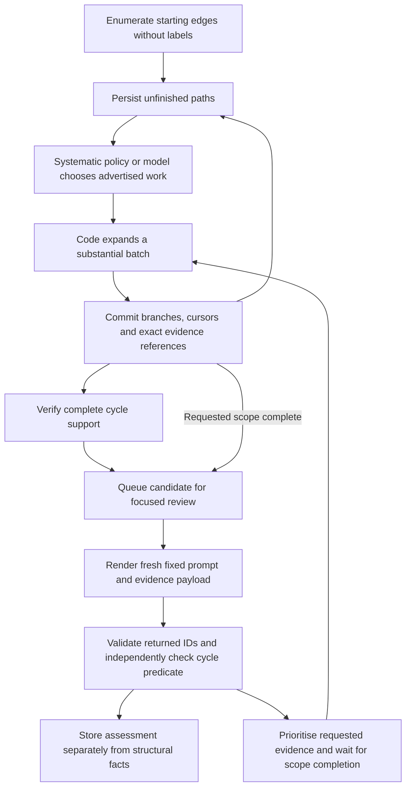

# Family 1: short temporal return cycles

Implementation milestone, 24 October 2026. This adds the rule, fixed prompts, navigation tools, persistent offline discovery, model-request/reply contracts, and a source-derived development graph. It does not restart the previous batch investigation or establish model detection performance.

A subsequent [controlled live evaluation](../../experiments/2026-10-24-cycle-context/README.md) measures exact tokenizer admission, context size, grouping and overlap. Its experiment harness is separate from this offline workflow; it did not validate a production view size. The zero-call statements below describe this original implementation milestone.

## Start here

- [Rule and system prompts](CYCLE-RULE.md): exact predicate, AUSTRAC/IBM provenance, review rubric and model responsibilities.
- [Dataset and catalogue](CYCLE-DATASET.md): source counts, selected episodes, ratio rounding, graph nodes, source verification and limitations. The preferred corpus is `generated/cycle-family-v2/`; v1 remains preserved.
- [Prompt implementation](cycle_prompts.py): `NAVIGATOR_SYSTEM` and `REVIEWER_SYSTEM` contain the fixed application-authored instructions. The current evidence and permitted work are separate payload data.
- [Tools](cycle_tools.py), [workflow](cycle_workflow.py), and [evaluator-only preparation](cycle_benchmark.py).

The first predicate is a simple return cycle with two to four distinct external edges, exact bank/account identity, and strictly increasing recorded timestamps. All edges lie in the declared source interval. There is no default 24-hour limit or same-currency requirement. Optional duration and maximum-edge parameters are pinned in the run configuration. A verified cycle does not establish conserved funds, ownership, intent or laundering.

## Tool and navigation suite

| Interface | Purpose | Completeness contract |
|---|---|---|
| `seed_page(limit, cursor)` | Enumerate eligible external starting edges without labels | Original-row-ID pagination covers the declared source interval; seeding order is not chronology |
| `expand_frontier(paths, row_budget, cursors)` | Retrieve substantial batches of all eligible later continuations | Per-path cursors retain competing branches; the last permitted edge must close; incomplete pages remain pending |
| `get_transactions(transaction_ids)` | Restore exact source evidence | Requested order and missing/out-of-scope IDs are explicit |
| `verify_cycle(transaction_ids)` | Check the declared path against authoritative rows | Identity, external edges, simple nodes, closure, strict chronology, scope and optional duration; no economic verdict |

The source is opened read-only and tool results use an explicit evidence-column allowlist. The workflow rejects a ledger path that aliases its source, including symlinks and hardlinks. A single writer owns each ledger. Source/subset identity, scope and policy are bound to continuation cursors and the ledger configuration.

For navigation, the model prioritises advertised partial-path scopes or selects systematic work. Code owns page sizes, continuation cursors, deduplication and branch expansion. Selection never deletes other pending scopes. A 1,000-row retrieval allowance in the CLI is an I/O bound, not a recommendation for LLM view size. Empty query results can finish a specific branch; they do not declare an account benign.

## Overall logic



Discovery and assessment are separate. The offline baseline exhausts every eligible starting edge and continuation within the selected database, time scope and two-to-four-edge predicate. It never reads the evaluator. This does not claim exhaustive longer-cycle discovery or completeness in the original database when running against a subset.

Rows leaving a model view are still available from the immutable source. Partial paths and cursors live in the ledger. A process restart reconstructs work from those records; no model-written summary is needed to preserve graph continuity. Page retrieval and progress commit together. Replaying a committed navigation response or assessment returns the saved result without repeating its effects.

The reviewer can propose a new exact edge sequence from the supplied evidence rather than selecting only preassigned candidate IDs. Every proposed cycle is verified before acceptance. Its assessment can remain `insufficient_evidence` despite a valid structure. Qualitative explanations remain model rationale and are not certified by the structural verifier.

Candidates omitted from a reply remain unassessed. A response requesting additional advertised work links the affected candidates to those scopes. Their review waits until that work completes, then includes the new retrieved evidence. Requests that already completed are recorded as such, with their earlier retrieved evidence restored from saved events. Partially completed scopes combine their saved pages with later pages. Assessment receipts remain immutable; later attempts have a new request identity. Other incidental surrounding evidence does not yet automatically invalidate an old assessment; explicit follow-up drives reassessment in this milestone.

There is no mandatory reviewer call after each retrieval action and no routine no-candidate reviewer packet. Exploratory review requires explicitly supplied evidence. No fixed total chunk count is needed for offline discovery; each action is resumable.

## Model integration scope

`packet('navigator')` and `packet('reviewer')` return native function-call requests with the fixed system prompt, evidence, permitted work and a packet ID. `accept_navigation(packet_id, answer)` validates and executes the selected work; `accept_review(packet_id, answer)` checks factual references and stores the assessment/follow-up disposition.

The packet builder records serialized request bytes and explicitly marks `token_admission: not_evaluated`. It does not claim bytes are tokens or that a row ceiling is a quality threshold. Each request is freshly rendered, but actual tokenizer admission, an empirically chosen one-third ceiling, hosted-call journalling/recovery and autonomous provider dispatch are not implemented in this new workflow. The existing NVIDIA adapter can be integrated in the subsequent controlled model experiment; no hosted inference was launched for this milestone.

The current packet candidate count is caller-selected and changes neither the cycle predicate nor cumulative work coverage. The response schema does not impose the old six-observation cap. A live caller still needs an output reserve and task-quality-tested input allowance before dispatch.

Runtime/evaluator directories separate data roles; they do not constitute an OS sandbox. A blind investigating process must be given only the runtime database and named tools, without access to the answer-bearing catalogue, evaluator files, preparation code or this research conversation.

## Run the offline baseline

From `prototype/local-data`, use the prepared runtime graph and a separate ledger:

```sh
python3 cycle_workflow.py discover --database generated/cycle-family-v2/runtime/transactions.sqlite --ledger generated/cycle-family-v2/baseline/ledger.sqlite
```

`discover` continues until scoped structural discovery completes. Interrupting between committed actions preserves all unfinished work; the same command resumes it. `advance` performs one retrieval action; `status` reads the recorded progress. The default interval is `[2022/09/01 00:00, 2022/09/19 00:00)`, which includes v2's boundary-spanning target. Narrowing the interval requires a separate ledger and changes the eligible denominator.

Prepare a review request without calling a provider:

```sh
python3 cycle_workflow.py reviewer-packet --database generated/cycle-family-v2/runtime/transactions.sqlite --ledger generated/cycle-family-v2/baseline/ledger.sqlite
```

An existing completed discovery ledger is safe to reopen: it does not reseed or requery completed work. Creating another ledger creates a separate reproducible discovery attempt.

## Completed v2 baseline

The offline run completed the full sample interval with **265,028 external starting edges**, **29 structural cycles** and **zero pending scopes**. There were 28 two-edge cycles, one three-edge cycle and no four-edge cycles. An [independent SQL audit](generated/cycle-family-v2/baseline/structural-audit.json) joined the source tables directly without importing the discovery algorithm or reading labels: its exact ordered transaction paths matched all 29 ledger candidates, with zero missing or extra paths.

The separate [post-run evaluator comparison](generated/cycle-family-v2/evaluator/baseline-evaluation.json) recovered both selected short-cycle reference episodes. Of the 29 structural cycles, 21 contain no positive-labelled edges, five contain only positive-labelled edges, and three contain a mix. This illustrates why structural discovery and suspiciousness assessment need separate outcomes. Additional positive cycles are not automatically new publisher family assignments. Two deliberately selected reference episodes cannot establish population detection quality.

The [run report](generated/cycle-family-v2/baseline/report.json) records 17,969 retrieval actions, 1,111,542 persisted partial paths and an 860,631,040-byte ledger. That state cost is a material scaling limit: this is a resumable correctness baseline, not a production-scale storage design. The independent audit is reproducible with:

```sh
python3 cycle_audit.py --database generated/cycle-family-v2/runtime/transactions.sqlite --ledger generated/cycle-family-v2/baseline/ledger.sqlite --output generated/cycle-family-v2/baseline/structural-audit.json
```

Run from `prototype/local-data`. The audit fails if a query times out or if coverage/path checks fail; it does not turn an incomplete query into a successful result.

There were **zero hosted calls and zero model assessments**. A [representative review request](generated/cycle-family-v2/baseline/review-request.json) was prepared but not submitted; it is 27,568 serialized bytes and has no calibrated token admission. The report records hashes for the code saved in `baseline/frozen-source/`, preserving the exact discovery implementation independently of later review-contract fixes.

## Validation

The new tests cover exact source matching, ratio arithmetic and infeasible sizes, whole episodes and incident context, node identity, strict timing, source immutability, read-only tool output, competing paths, pagination, restart, transactional rollback, writer exclusion, source/ledger alias rejection, new reviewer proposals, factual rejection, immutable response replay, and follow-up reassessment.

```sh
python3 -m unittest discover -s prototype/local-data -p 'test_cycle*.py'
python3 -m unittest discover -s prototype/local-data -p 'test_*.py'
```

Run these two commands from the research root. The full suite passed 169 tests during this milestone, including delayed follow-up evidence and independent SQL-audit checks. The [saved test log](generated/cycle-family-v2/baseline/test-suite.log) records the completed run. Source verification covers every edge and node of the prepared graph. The offline baseline result is recorded beside its ledger and the label comparison is in the separate evaluator directory; they measure structural recovery, not live-model quality.
