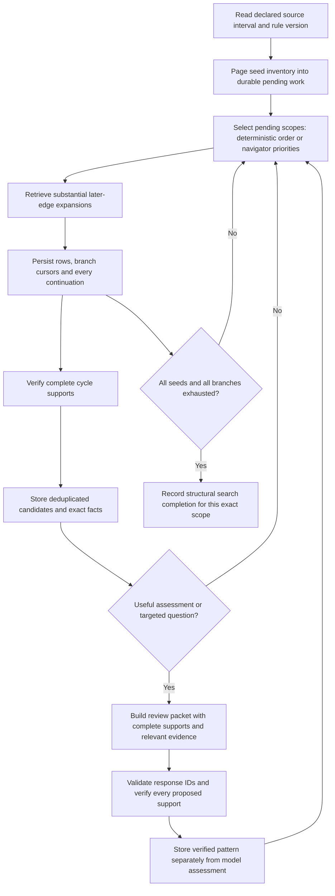

# Family 1: short temporal return cycles

Implemented contract, 24 October 2026. Version: `short-temporal-cycle-v1`.

This slice finds and verifies simple, time-ordered cycles of two to four transactions. It separates the observed pattern from an economic assessment and from the dataset's hidden laundering labels. The tools and prompt contracts are ready for local deterministic runs and saved model requests. No claim is made here about model detection quality, an optimal view size, or production readiness.

## Where the rule comes from

| Source | What it contributes | What it does not establish |
|---|---|---|
| [AUSTRAC banking indicators](https://www.austrac.gov.au/industry-and-business/education-and-resources/publications-and-resources/indicators-suspicious-activity-banking-sector) | Qualitative reasons to examine unusual or complex transfers and customer context | An official two-to-four-edge cycle rule, a 24-hour threshold, or a laundering verdict from topology |
| [IBM AMLworld paper](https://arxiv.org/html/2306.16424v3#S3.SS2) | The synthetic benchmark's graph motifs, including cycles | Equivalence between publisher CYCLE membership and our strict temporal predicate |
| This experiment | Exact edge, identity, time, scope and verification rules | Proof that those engineering choices are best for operational detection |

The [source-mapping research](../../research/2026-10-23-rule-family-slices.md) contains the underlying review. The fixed system instructions include this separation; it is no longer left implicit in a broad instruction to “look for cycles.” The model receives ordinary transaction evidence without labels or reference-pattern membership.

## Observable predicate

For ordered edges `e1 … ek`, with account path `v0 → v1 → … → vk`, accept a cycle only when:

1. `2 ≤ k ≤ max_edges`, with `max_edges` between two and four; the default is four.
2. Every transaction ID exists in the selected immutable source and declared `[start, end)` interval. IDs retain the original source hash and source row ordinal.
3. Every edge is external: its source and destination `(bank, account)` pairs differ.
4. Adjacent endpoints match exactly on **both bank and account**. Raw account numbers alone are not identities.
5. `vk = v0`, and `v0 … v(k−1)` are all distinct. No repeated internal node or repeated transaction edge is allowed.
6. Recorded timestamps strictly increase: `t1 < … < tk`. The source has minute precision. Equal timestamps are not ordered by row ordinal or by the order they appear in a file.
7. If `max_duration_minutes` is supplied, `tk − t1` does not exceed it. `None` imposes no duration limit beyond the declared source interval. There is no implicit 24-hour rule and no separate adjacent-gap filter in v1.

Mixed currencies and unequal amounts do not fail the predicate. The verifier returns elapsed minutes, account nodes, currencies and exact source rows. It does not calculate an amount-conservation score or assume a conversion rate. A compatible-currency amount comparison is still not proof that an outgoing payment used a particular incoming payment's funds.

For example, `A → B → C → A` with three strictly increasing times is an eligible structure. A missing closing edge, a `B` at a different bank, or a timestamp tie prevents those exact edges from satisfying the predicate. A structurally valid cycle can still have an ordinary business explanation.

## Tool and navigation suite

[cycle_tools.py](cycle_tools.py) opens the transaction database read-only and exposes explicit methods. The model does not write SQL or manipulate page cursors.

| Method | Question answered | Result and completeness |
|---|---|---|
| `seed_page(limit, cursor)` | Which external transactions in the declared interval remain available as starting edges? | Rows, next cursor and completion for the seed inventory. It pages by original row ordinal, not by global time. |
| `expand_frontier(paths, row_budget, cursors)` | Which strictly later outgoing transactions can continue or close these exact partial paths? | Every eligible extension in the returned pages, split into cycles and open continuations, with a separate cursor and completion flag for each input branch. |
| `get_transactions(transaction_ids)` | What are the authoritative rows for these exact IDs? | Rows in requested order plus unavailable IDs. |
| `verify_cycle(transaction_ids)` | Do these exact ordered edges satisfy the configured rule? | `valid`, errors, source evidence, elapsed minutes, nodes, currencies and an explicit claim limitation. |

Expansion follows outgoing edges from the current path's last account. It preserves competing continuations and possible closing edges; it does not pick only the earliest successor. At the final permitted hop, only a return to the starting account can qualify. The page order uses timestamp and row ordinal to enumerate distinct rows reproducibly; the path predicate still requires strictly later timestamps between successive edges.

A response row budget limits one retrieval burst, not total investigation coverage. `complete=true` means no eligible rows remain **after that page**; earlier pages must be retained to cover the whole query. An unfinished branch carries its continuation cursor. Exhausting one branch does not finish the seed inventory or other branches. Cursors are bound to the source, scope, rule parameters and queried path.

The scheduler presents pending work as integer `scope_id` values with exact partial paths and their next account/time/direction scope. The navigator selects up to four advertised IDs or `scope_ids=[]` for systematic work. Unselected work remains pending. Code handles substantial retrieval, indexing, deduplication, cursor persistence and later resumption. The first suite deliberately follows cycle continuations; general incoming-history and customer-document investigation are future capabilities, not implied by the current tool names.

## Overall logic and division of responsibility



The diagram describes the intended use of the new pieces. The workflow's current execution modes and commands are documented with [cycle_workflow.py](cycle_workflow.py); saved requests and imported responses do not establish that a hosted model has run.

The runtime owns exact identity, chronology, bounded traversal, persistence, budgets and coverage. The navigator chooses priorities within available work. The reviewer proposes exact supports, gives a limited interpretation, or asks to advance a relevant advertised scope. The evaluator alone owns hidden labels and source-pattern membership. These roles do not exchange labels through case names, prompt fields or tool results.

Label separation applies to the named model tools and prepared request payloads. This module does not provide an operating-system sandbox: an agent separately granted filesystem or shell access could reach evaluator files. A future hosted runner must expose only the intended model tools and keep evaluator data outside that surface.

The database page, retrieval burst, visible view, context refresh and review trigger are different boundaries. A full context starts a fresh request from saved evidence references and unfinished work; it does not close a case or trigger an empty review. A candidate should be assessed when complete, materially changed, or accompanied by a concrete unresolved question. The current offline workflow can prepare packets for that role; the policy has not yet been validated in a hosted agent experiment.

Source-wide structural completion requires the full external-edge seed inventory and every resulting eligible branch to be exhausted under the declared parameters. Merely retrieving an account, displaying a row, or importing a review response is not that completion criterion. Budget exhaustion leaves work pending. This bounded family cannot establish absence of longer cycles, activity outside the interval, or other laundering patterns.

## Fixed system prompts and model output

[cycle_prompts.py](cycle_prompts.py) is the single source for `RULE_SYSTEM`, `NAVIGATOR_SYSTEM`, `REVIEWER_SYSTEM`, the two function definitions and response validation. All fixed investigation rules live in the system prompts. The application-created user-role payload carries the current scope, source/rule version, rows, verified facts and pending work. “User-role” is an API role; the human is not being asked to supply the rules on each request.

`choose_cycle_scopes` returns:

```json
{"scope_ids": [7, 9], "reason": "Resolve the two pending return possibilities."}
```

`assess_cycle_evidence` returns observations and optional requests independently:

```json
{
  "observations": [{
    "transaction_ids": ["source_hash:101", "source_hash:204", "source_hash:310"],
    "pattern_present": true,
    "status": "insufficient_evidence",
    "reason": "The verified transfers form a temporal return; their economic purpose is unknown.",
    "limitations": ["No customer-purpose or balance evidence is supplied."]
  }],
  "evidence_requests": [{
    "scope_id": 7,
    "reason": "Inspect the advertised competing continuation before assessing the episode."
  }],
  "limitations": []
}
```

The example IDs are placeholders, not permitted runtime IDs. Real outputs must reference exact supplied IDs. A reviewer may propose a new two-to-four-edge support from the view without a preassigned candidate ID. It may also return no observations and a targeted request. It is not forced to produce a finding whenever rows appear.

| Field or status | Meaning |
|---|---|
| `pattern_present` | A factual assertion about these exact edges under the configured predicate; code checks it. |
| `investigate` | A verified cycle has a specific evidence-backed reason for human follow-up. This is not a laundering verdict. |
| `insufficient_evidence` | Available economic/contextual evidence does not support a stronger assessment; this is valid even when a cycle is present. |
| `not_supported` | The proposed short-cycle hypothesis fails, or supplied evidence specifically contradicts the stated concern. It is not an account-level benign verdict. |
| `evidence_requests` | Named questions linked to advertised work that the runtime can perform. Missing customer information is a limitation when no tool can obtain it. |

The rubric asks for one or two grounded sentences per observation. It prohibits unsupported claims about fund conservation, common control, intent, geography, currency conversion and numerical risk. Alternative explanations remain hypotheses unless independently evidenced. No candidate in a view does not mean the account is benign or the search complete.

## What validation does and does not prove

The schemas use the project's native function-call format and existing JSON-schema subset. Local validation rejects unknown fields, malformed types, oversized outputs, duplicate edges or supports, unadvertised scope IDs, unsupplied row IDs, missing reasons, and an `investigate` status for a failed pattern. Source-unavailable evidence is rejected rather than accepted as a negative finding. Every accepted observation receives the authoritative `verify_cycle` result; a model's `pattern_present` must match it.

Long source-qualified row IDs are not repeated in JSON-schema enums. Runtime membership checks enforce the permitted IDs. The NVIDIA adapter removes unsupported `uniqueItems` constraints only for the provider grammar; the original schema is still enforced locally. Native response parsing must also reject truncated output, multiple calls, and a call to the wrong function.

Free-text reasoning is **not** semantically proved by these checks. The stored verification concerns exact graph and time facts; the model's economic interpretation remains attributed model rationale. Human or separately evaluated review is needed before treating that interpretation as reliable. A valid JSON response and a correct cycle do not establish AML detection quality.

Focused contract checks are in [test_cycle_prompts.py](test_cycle_prompts.py). They cover novel support without candidate IDs, supplied-ID enforcement, contradiction with source verification, unavailable evidence, separate pattern/assessment status, targeted follow-up, empty findings, duplicate handling, compact schemas and native response truncation. The navigation suite tests the actual graph and paging behavior independently.
