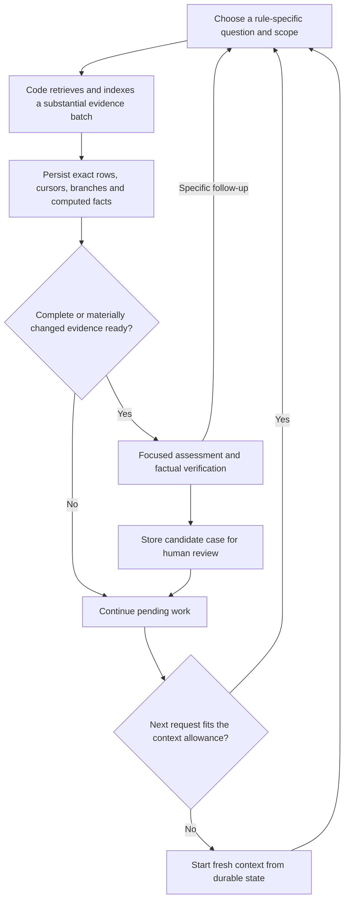

# Focused rules, smaller benchmarks and continuing graph investigation

Discussion synthesis from three parallel research agents and a read-only inspection of the current prototype. Research began 23 October 2026, Australia/Sydney. This is a proposed next experiment, not implemented behavior. No prototype inference calls, investigation restart, heartbeat change or code changes were made.

## Recommendation

Build one rule-family worker over a shared persistent evidence store. Let it choose meaningful graph queries, have code retrieve and index substantial amounts of relevant evidence between model calls, and assess complete evidence units under a focused rule contract. Refresh model context independently of retrieval pages and review scheduling. Start with a small temporal-cycle experiment and test whether model involvement adds value over a deterministic query.

The desired product remains a script that reads a database and produces reviewable candidate cases: exact supporting transactions, observable pattern, reason for concern, counterevidence, missing information and confidence limitations. A confirmed pattern is distinct from a laundering verdict. Numerical probabilities should not be presented as calibrated unless separately evaluated.

## 1. Choose the rules before choosing the traversal

AUSTRAC provides qualitative indicators and contextual requirements. IBM supplies a synthetic benchmark with eight standard graph motifs and additional illicit activity. Neither supplies an official eight-rule executable detector. A rule card should identify its source rationale, exact observable predicate, field dependencies, missing prerequisites, parameters and testable completion condition. [AUSTRAC banking indicators](https://www.austrac.gov.au/industry-and-business/education-and-resources/publications-and-resources/indicators-suspicious-activity-banking-sector), [IBM AMLworld paper](https://arxiv.org/html/2306.16424v3#S3.SS2)

| Specialist | Natural evidence unit | How to move through the graph |
|---|---|---|
| Short temporal cycles | Complete return path plus relevant surrounding transfers | Follow later outgoing edges, preserve competing continuations, and query possible return edges |
| Fan-in/out and gather-scatter | Account activity in a declared time window | Retrieve both directions in batches; compute distinct counterparties and per-currency totals over the complete declared scope |
| Scatter-gather | Several branches and their common destination | Expand branches together and preserve evidence needed to compare reconvergence |
| Layered distributions | Multiple source/intermediate/destination relationships | Search bounded layers with durable branch state; defer until simpler slices are understood |
| Changes from prior activity | Current account episode plus comparable earlier history | Move through time as well as neighbouring accounts |
| Customer, ownership and jurisdiction concerns | Transactions joined to validated contextual records | Obtain missing data; do not infer country, ownership or purpose from transaction identifiers |

These are engineering groupings. A specialist can be the same worker code with a different rule card, query policy and evaluation rubric. Related rules can share retrieval while returning separate assessments. Launching eight independent workers immediately would duplicate evidence acquisition and alerts before their usefulness is known. See the [rule-family research](2026-10-23-rule-family-slices.md).

**Proposed first slice:** simple time-ordered return cycles of two to four edges. This matches the user's examples and makes evidence checking clear. It is a proposed experiment boundary, not a claim that longer cycles are unimportant or that these are the cheapest database queries. Code can find this topology directly, which gives a strong baseline against which to assess the agent.

Do not initially require a 24-hour duration, equal currencies or near-equal amounts. Report timing and compatible-currency amounts as measurements. A 24-hour limit is a parameter to test; a same-currency filter changes the target and does not make a path into proof of the same funds moving. Unknown or tied chronology must remain explicit.

## 2. Build small source-preserving benchmarks

The evaluator may use hidden answers to assemble development fixtures. The investigator must receive only ordinary transaction fields and authorised account metadata. Hidden labels, pattern membership, fixture names and selected-positive identifiers must not leak through runtime tools or filenames.

The primary HI-Small period has 4,522 labelled transactions among 5,077,237 rows, approximately 0.0891%, or one positive per 1,123 rows. One positive with 99 negatives produces an intentionally enriched 1% fixture. It is useful for controlled stress testing, but does not reproduce source prevalence or the distribution of connected activity. The sparse tail has a very different label distribution and should remain separate. [Existing evaluator profile](evidence/evaluator-hi-small-profile.json)

The new small-pattern audit identifies 54 publisher CYCLE groups. Only five fit within 24 hours; all five are two-edge returns. The proposed primary-period, two-to-four-edge, simple, time-respecting subset has 27 groups, spread across 20 account-overlap clusters. These are development opportunities, not 27 independent untouched test cases. Publisher motif membership, an observed static cycle, and a strictly chronological cycle are different ground truths. The [benchmark note](2026-10-23-small-rule-benchmark.md) records the counts, procedure and limitations.

Use three layers:

1. **Constructed mechanics fixtures.** Complete cycles and topology/chronology near misses: wrong bank identity, wrong direction, missing closure and timestamp ties. Include valid cross-currency cycles that must not support amount-conservation claims, and evidence spanning a context refresh. These test exact logic. Clearly mark modified or planted data as constructed.
2. **Source-preserving neighbourhood fixtures.** Extract complete eligible reference patterns and ordinary activity around the same accounts and times. Use real distractors; preserve source IDs, time and monetary fields. Include label-zero examples that match the suspicious-looking shape, and labelled examples outside the chosen rule. A positive seed does not make every neighbour positive; a zero-label seed does not make its neighbourhood benign. Group overlapping episodes before partitioning and recheck overlap after expansion.
3. **A later label-blind mini-stream.** Freeze the rule and sampling method, then take a chronological or otherwise predeclared source slice without selecting it through answers. This tests candidate generation, missed cases and human review burden under a defensible denominator. HI-Small has already been explored, so it cannot support a claim of untouched confirmatory evaluation merely by hiding labels in prompts.

Report structural predicate recovery, reference-pattern recovery and benchmark-label precision/recall separately. Also report false alerts, duplicate cases, incomplete scopes, unsupported claims, latency and model cost. Do not extrapolate enriched-fixture precision to a population with a different prevalence.

## 3. Separate five boundaries that the prototype currently mixes

| Boundary | What should determine it |
|---|---|
| Database page | Efficient bounded I/O and a durable cursor |
| Investigation work item | A question about a rule, accounts and time range |
| Evidence view | Complete relevant evidence units within a measured model budget |
| Context chunk | Token allowance, projected next tool result/output and saved state |
| Review trigger | Complete or materially changed support, a resolved search scope, or a concrete evidence question |

A context refresh should not force a reviewer call. A SQL page should not require a new navigation decision. A nearly full view should not close unfinished graph work. Conversely, there is no reason to pad a complete small case with irrelevant rows merely to fill capacity.

The current batch runner already reconstructs each request from a system message and the current payload; it is not accumulating an endless chat transcript. Its immediate problems are evidence selection and review scheduling. A new chunking engine alone would leave those problems intact.

The proposed sequence is:



The navigator chooses priorities and investigative questions; the runtime expands selected scopes automatically until the useful evidence allowance or a meaningful scope boundary is reached. If ten rows are visible and a validated view can hold roughly 300, it should retrieve a substantial relevant batch without intermediate model approvals. A busy account may require far more rows to be queried or indexed than the model needs to see. Exact aggregate results can refer to supporting source rows stored outside the prompt.

On rollover, retain source/rule versions, exact evidence references, checked scopes, incomplete scope cursors, alternative branches, time bounds, candidate revisions and targeted questions. Brief prose helps orient the next context but is not the authoritative memory. Evicting rows from a prompt must not delete evidence or silently mark unvisited work complete. A separate global inventory must eventually schedule unvisited components/scopes; a model's preferred direction does not establish whole-source coverage.

An overlarge single evidence unit must remain incomplete with an explicit strategy: narrower scoped queries, a verifiable aggregate, or another bounded continuation. Never truncate its decisive support and call the rule checked. These are application responsibilities even when middleware handles model-message replacement. See [context and review-boundary research](2026-10-23-context-and-review-boundaries.md).

## 4. Treat one-third context as a proposed ceiling

The current adapter uses NVIDIA `nemotron-3.5-lightning-30b-a3b`. Its [model card](https://build.nvidia.com/nvidia/nemotron-3.5-lightning-30b-a3b/modelcard) advertises up to one million context tokens; the exact accepted combined context limit of the configured hosted endpoint has not been verified. The documented output-token cap is a separate quantity. Official API links and endpoint caveats are in the [context research](2026-10-23-context-and-review-boundaries.md).

A starting policy can honour the user's one-third idea without claiming it is a proven smart zone:

```text
working allowance = min(one-third of verified usable context,
                        task-quality-tested allowance)

instructions + tools + retained state + visible evidence
  + projected next tool result + output reserve + margin
  <= working allowance
```

Count the complete rendered request with the matching tokenizer where available, and compare estimates with provider usage. Refresh before the next step would exceed the allowance. Do not fill a nominal 333k-token context merely because the model card permits a much larger window. General long-context research finds that effective performance depends on task complexity and context length; it does not establish a Lightning-specific fraction. [RULER](https://arxiv.org/abs/2404.06654), [NoLiMa](https://arxiv.org/abs/2502.05167)

There is no measured best row count for this new slice. The old 40–1,500-row study used Ultra, not the current Lightning model, and every size had an invalid-edge counterexample. Current Lightning experiments separately show factual and control-discrimination failures. Raw row count, token count, branching, candidate count and evidence placement all matter.

Test a compact ladder such as 100, 300, 600 and 1,000 rows on the same complete target evidence, adding controlled source distractors; treat those sizes as experimental settings only. Also compare retrieval policies against the same underlying source scope, since enlarging a packet and improving retrieval answer different questions. Vary graph degree, evidence placement/order and the number of complete candidates. Predeclare factual-quality and recovery criteria and select the size/policy with the best cost per correctly recovered, grounded case among those passing. If no size passes, change the task representation or model before scaling.

## 5. The model must have a useful job

For the first slice, compare deterministic temporal-cycle discovery with the same evidence reviewed by a focused model, then add adaptive investigation only if warranted. Code should calculate identity, chronology, elapsed times and per-currency values. The model can interpret supplied facts, state uncertainty, identify counterevidence and ask a targeted follow-up. If it proposes a new candidate from the view, require exact transaction IDs and verify its rule predicate before recording it.

Do not limit the new interface to a fixed list of path IDs if the intended experiment includes model-led discovery. Separate outputs for observed pattern, suspicion hypothesis, missing information and requested evidence. A reviewer can say that a pattern is present while the available context is insufficient to justify a stronger claim.

Put the selected, versioned rule card into the application's fixed instructions, with transaction evidence in a separate data payload. The application authors both; an API message labelled `user` does not mean the human wrote its contents. Source provenance and the operational predicate should be visible in the rule card, rather than implicit in broad pattern words.

In the stopped ledger, 324 of 356 committed review receipts contain no decisions. The current schema requires an empty decision list when the code supplies no paths, so those calls cannot originate a finding. Replace that automatic schedule with candidate/episode-driven assessment plus a measured sample of no-candidate regions to audit omissions. This changes what “reviewed” means and must be reflected in coverage metrics. The model should not quietly lose access to non-candidate evidence if discovery is part of its task.

Batch multiple complete candidates when quality tests support it. Reassess only when their support or interpretation materially changes; unchanged rows alone do not justify a new call. Further rule-family workers should share retrieval caches, immutable evidence, candidate deduplication and provider budgets.

## Current-state evidence and document corrections

The latest ledger was opened through SQLite `mode=ro`, without instantiating the agent. It remains `paused_user`, with 35,147 discovered rows, 183 retrieval pages, 34,954 rows presented, 154 assessed paths, 33 complete checkpoints and checkpoint 34 in review. One admitted model request has no known provider outcome. The 4,114,006 reported tokens exclude its 21,498-unit accounting reservation. No full audit of the latest trace or detection evaluation was performed here.

The current implementation uses a 24,000-unit byte-based allowance, a 500-row configured ceiling in that run, 1,500-row/100-page retrieval checkpoints, six-path packets and mandatory review. These are present mechanics, not this proposal. Current candidate generation greedily selects one earliest later edge per step, with a six-edge cap; it is not exhaustive cycle discovery. The next first-slice comparison must not mistake that generator's misses for model detection failures.

The main handoff, research index, batch prototype description, older batched-exploration status and prototype entry page were updated to distinguish current state, historical results and proposed work. Original experiment reports and evidence remain intact. The older AUSTRAC research was still consistent with the official source, so its source claims did not need rewriting.

The next useful decision is whether to adopt the proposed short temporal-cycle slice. Its purpose is to establish one measurable rule, an honest small benchmark, and a review boundary that works before adding rule families or returning to a large scan.
