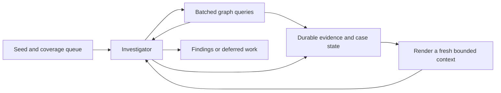

# Adaptive graph investigation with bounded model context

Research/design assessment: 23 October 2026. This is a proposed experiment, not an implemented detector or a measured claim of improved recall. The excluded original proposal and its rule list were not used.

## Assessment

The proposed agent is a reasonable investigator: start from a transaction or account/time region, query surrounding activity in batches, choose follow-up questions, and continue across context refreshes. The promising contribution is adaptive allocation of investigation effort. The database performs retrieval, joins and exact calculations; the model chooses and interprets queries.

Two different problems must remain explicit:

1. **Investigation continuity:** keep one case coherent when its total retrieved evidence exceeds one model context.
2. **Population coverage:** choose which regions of a very large dataset get investigated, and record what remains unexamined.

Context compaction can help the first. It does not establish the second. Starting from an arbitrary transaction is valid for a demonstration or an exploration arm. A resource-bounded adaptive walk from that point does not guarantee discovery of distant suspicious episodes, even when they lie in the same connected component.

The previous experiment measured token capacity, not model quality. Approximately 1,000 compact transaction rows is a reasonable first test size, not a proven safe size for many models. Enforce the selected model's complete-request token budget; account dictionaries, rules, history, tool results and generation all matter. [Local measurements](../experiments/2026-10-23-context-budget/README.md)

## Research basis

- Anthropic describes just-in-time retrieval using durable references, compaction, external notes and focused subagents. It also notes that exploration can waste work or miss important information. These support the architecture as an engineering pattern, not its AML accuracy. [Context engineering](https://www.anthropic.com/research/effective-context-engineering-for-ai-agents)
- IBM's Graph Feature Preprocessor research treats transactions as temporal multigraph edges and computes local statistics and motifs using batched processing. Time windows and path-length bounds constrain searches. This supports implementing efficient graph operations beneath an agent; it does not show that an LLM should perform the enumeration, nor establish thresholds for our application. [GFP paper](https://arxiv.org/html/2402.08593v2)
- AUSTRAC describes indicators as inputs to alerts and further review, and the list as non-exhaustive. Relevant observations include rapid multi-account movements and outgoing payments shortly after receipts. Several interpretations require customer profile or purpose data unavailable in our CSV. [Banking-sector indicators](https://www.austrac.gov.au/industry-and-business/education-and-resources/publications-and-resources/indicators-suspicious-activity-banking-sector)
- The framework review distinguishes Meterless Markovian's generator/carryover mechanism from application-owned graph navigation and durable state. [Framework source review](adaptive-graph-framework-review.md), [previous implementation probes](agent-frameworks.md)

The recommendations below are our design inferences. None of these sources validates this complete proposed AML agent.

## Graph shape and investigation boundaries

Repeated smaller shapes are usually discussed as motifs. Isomorphic structures have the same connectivity after renaming vertices; their timestamps, amounts, currencies, ownership and purpose may differ. A cycle-shaped subgraph is not inherently suspicious. A temporal path must respect the declared chronological rule; source row order does not establish chronology when minute timestamps are equal.

The investigator works with overlapping evidence views. A view can focus on an account, several accounts, a time interval, a path hypothesis or a convergence question. It need not be isolated from the rest of the network, and its evidence need not be disjoint from another case. Preserve edge identities and links between cases.

In the full-file audit, one component contains 95.99% of HI-Small rows and 99.70% of HI-Large rows. Therefore, reaching a connected neighbor is not by itself a reason to keep expanding. The next query should address a stated question with a bounded scope. [Measured component inventory](../experiments/2026-10-23-full-components/README.md)

## Proposed system responsibilities

| Part | Responsibility |
|---|---|
| Dataset scheduler | Maintains a queue of seeds/regions, selection policy, coverage and shared resource budget |
| Investigator | Chooses the next question, query scope, branch priority and interpretation |
| Database/graph tools | Perform batched retrieval, aggregation, bounded temporal joins/path searches and exact checks |
| Evidence and case store | Retains source rows or stable references, query receipts, findings and unfinished actions |
| Context builder | Renders the current working view and case state within the token allowance |
| Evaluator | Owns hidden labels/patterns and measures outcomes after runs |

The scheduler can initially be ordinary application code. This proposal does not require another LLM manager.



## Batched tools, rather than one-edge steps

These are proposed application interfaces, not existing Meterless API functions.

| Tool | Typical request | Result |
|---|---|---|
| `summarize_activity` | Several accounts, direction, interval and grouping | Counts, distinct counterparties, time ranges, per-currency totals and evidence references |
| `fetch_transactions` | Explicit accounts/time/filter scope or selected transaction IDs | Exact rows with stable IDs and pagination/coverage metadata |
| `expand_frontier` | Selected accounts, incoming/outgoing direction, interval and bounds | Batched neighbors and supporting rows, including deferred work |
| `trace_paths` | Start/target sets, time-order semantics, maximum hops and interval | Bounded path candidates and their edge IDs; incomplete searches explicitly marked |
| `verify_evidence` | Proposed path, aggregate or claim plus IDs | Deterministic identity, time, currency and arithmetic checks; no claim of criminal intent |
| `record_case_update` | Findings, alternatives, pending actions and stop status | Validated durable state transition |

The initial tool set can be smaller; path search is optional until its added value is tested. General retrieval, grouping and join operations permit exploration beyond a fixed catalogue of eight motif families. The investigator can combine operations and ask new supported questions without being given the answers.

For example, a tool can summarize outgoing activity for 20 accounts in one request. The model can then inspect the evidence behind the two groups relevant to its question. SQL/graph code may examine many more rows than are rendered to the model. An aggregate must expose its exact scope, units, supporting query and a way to retrieve raw evidence.

Every tool is constrained by dataset version, reporting/history windows, knowledge cutoff, allowed fields and a resource budget. Runtime access excludes evaluator labels and pattern answers. Start with validated read-only query operations; if generated SQL proves necessary, validate and limit it at the backend rather than trusting prompt instructions.

Bound both **database work** and **returned context**. `LIMIT 1000` can still sit above an expensive join or sort. Set query deadlines and scan/work limits where supported, constrain path depth/time, and retain resumable cursors or deferred actions. Indexed account/time access and appropriate analytical storage should be evaluated; repeatedly scanning the raw large CSV for every hop is not the target design.

Query receipts record filters, ordering, version, returned IDs, available count/completeness information and remaining pages. If a full count is expensive or unavailable, say so. A limited top-ranked result is not a complete neighborhood. Retain the option to inspect other branches so ranking does not silently become a hard exclusion policy.

## What a chunk means

Use a **bounded period of investigation**, not a permanently assigned block of 1,000 rows. It may involve several model calls and several batched tool calls. It ends at a deliberate checkpoint: the next request would exceed its context allowance, an investigation milestone is reached, or a per-segment tool/time limit is reached.

The working evidence can grow, shrink and overlap with the next segment. One case may retrieve 10,000 rows over its lifetime while displaying only a selected subset at a time. Every displayed request still includes the account dictionary, scope, instructions, recent messages and appropriate generation reserve. Counting only the newly fetched rows is insufficient.

Persistence and compaction are separate operations:

- Persist every successful query receipt and validated state update during the loop, not only when the context fills.
- Keep immutable transaction evidence or exact versioned references outside the prompt.
- Keep a machine-readable queue of unfinished queries/branches, including their reason, scope and cursor.
- Keep findings with cited IDs, alternatives, limitations and explicit verification status.
- Keep a compact narrative to orient the next context. It is not the sole copy of facts or work remaining.
- Render the next context from this state plus the exact rows needed for the next question. Reinsert the governing instructions and rule versions.

Trimming means evicting rows from the current prompt. It must not delete source evidence, remove pending work or mark an unseen region benign. A later query can recover evicted evidence by ID. A large pending-work queue can itself be paged; the entire queue need not be pasted into every prompt.

Continuity belongs to the case identity and stored state. The next context can be another call of the same logical agent. Creating a new agent identity is optional.

## Illustrative end-to-end flow

This is an invented example explaining control flow, not an additional result on IBM data.

1. A seed transaction moves funds from A to B. The case opens with its reporting window, history allowance and rules. The agent asks whether this is part of rapid onward movement.
2. One batched query summarizes A and B's activity around that time. It reveals incoming payments to A and outgoing payments from B to C and D. The agent retrieves the relevant source rows and also compares earlier activity where available.
3. The agent asks whether C and D forward payments to a common recipient. A bounded temporal query examines both branches together. It returns supporting rows for one branch and a pending page for the other.
4. Before the next response would exceed the context budget, the runtime persists the evidence, the branch already checked and the exact pending query. A note states that common-recipient movement is still a hypothesis. The current prompt can release unrelated detailed rows.
5. The next context receives the same case/rules, anchored evidence and pending branch. It retrieves the outstanding page, checks whether the branches converge, and asks for deterministic verification of the claimed path and amounts.
6. The case records the observed structure and why it warrants review, together with plausible alternatives and missing economic-purpose information. Or it records insufficient evidence/budget exhaustion. A valid temporal path alone does not prove that the same funds moved or that laundering occurred.

Notice that the convergence evidence spans two segments. Resetting to unrelated row batches, or retaining only a vague narrative, could lose precisely the relationship the investigation is meant to discover.

## Population coverage and starting points

Arbitrary starts are useful as an experimental baseline. They should be reproducibly sampled and recorded. Sampling transactions uniformly gives more opportunities to high-activity accounts; sampling account/time regions changes that distribution. Neither is universally correct without a declared target and evaluation.

For a practical scheduler, compare a mix of:

- Priority seeds from inexpensive activity statistics or supported indicators.
- An explicit exploration share drawn from regions without those signals.
- A tracked queue of remaining account/time regions if systematic scheduled coverage is required.

The mix and budgets must be chosen and evaluated; no percentage is selected here. Rule hits need not be a hard gate: exploration can investigate regions they miss. Time partitions are scheduling boundaries, not episode boundaries; investigators need permitted lookback and cross-boundary evidence.

Maintain distinct statuses for scheduled, retrieved, assessed, partially explored and deferred work. A visited-account flag is too coarse. Coverage depends on dataset/version, account set, interval, direction, filters, pagination and query completion. Reusing a complete identical query result saves work; seeing an account once does not establish that every question about it was answered.

If every source row had to be displayed exactly once in 1,000-row packets, HI-Small would already require **5,079 packets** and HI-Large **179,703 packets**, before overlapping evidence or extra model turns. These are simple ceiling calculations from the measured file counts, not runtime forecasts or unavoidable lower bounds for an aggregate-query approach. Adaptive retrieval may display much less, but then coverage and missed positives must be measured honestly.

Keep case IDs stable and link overlapping investigations. Exact duplicate findings can be keyed by normalized evidence IDs and claim/rule version. Different cases sharing one account are not automatically duplicates. Overlapping evidence is often necessary; duplicate work and duplicate alerts are what the system should control.

## Subagents

Subagents can investigate well-defined branches: upstream funding, downstream convergence, or evidence against the leading hypothesis. Give each the same immutable case snapshot, explicit scope and an allocated share of the parent budget. Workers return evidence IDs, queries performed, unresolved work and verified calculations, alongside a short explanation.

The parent merges results and checks relationships across branches. Separate workers can miss a convergence that appears only when their results are joined. Shared query caching and ownership of pending work reduce redundant exploration. Parallelism can reduce elapsed time while increasing total tokens/database work; compare against a single investigator at the same total budget. Do not create a subagent for each ordinary query.

## Minimal conceptual control flow

```python
# Application pseudocode; not a Meterless or SDK API example.
for seed in scheduler.claim_work(run_budget):
    case = case_store.open_or_resume(seed)

    while case.is_open() and case.has_pending_work() and budgets.allow_next_segment(case):
        context = render_context(
            frozen_instructions, frozen_rules,
            case.compact_state(), case.select_exact_evidence(),
            complete_request_token_budget,
        )
        # Tool handlers enforce scope/budgets and persist receipts as they run.
        # Agent may execute multiple batched queries during this segment.
        result = run_bounded_tool_loop(context, case_scoped_tools(case))
        case_store.validate_and_save(result.case_update)

        if result.needs_context_refresh:
            case_store.save_orientation_note(result.summary)
            # Rehydrate exact state/evidence on the next iteration.
        else:
            apply_explicit_stop_or_continue_decision(result)

    record_completion_or_deferred_status(case)
```

A segment yielding no new evidence should not automatically restart forever. Total case/run budgets, repeated-query detection and explicit no-progress handling are required. Budget exhaustion leaves unfinished leads visible and is not a negative AML classification.

## Recommendation and next experiment

Start with an ordinary bounded tool loop, a durable case store and an explicit context renderer. Test Markovian as an optional context-policy adapter once the core investigation is measurable. Its chunk abstraction alone does not provide a transaction cap, SQL execution, coverage or durable recovery.

Separate three comparisons so improvements can be attributed:

1. **Navigation:** fixed expansion versus adaptive single-agent exploration, using the same seeds, tools, cutoff and total query/model budget.
2. **Context policy:** ordinary structured-state rehydration versus a Markovian adapter, holding the investigator's other choices fixed.
3. **Delegation:** single investigator versus limited branch workers, with the same aggregate resource budget.

Evaluate seed selection separately: arbitrary/stratified starts, prioritized starts and a mixed exploration policy. Avoid changing seed quality, tools, framework and parallelism all at once.

The evaluator should measure whole-population transaction recall and precision, review burden, conditional recovery around seeds, evidence/path validity, repeated queries, unfinished leads, database work, actual model tokens, cost and time. Count flagged transaction IDs separately from supporting contextual rows. Include multiple runs for stochastic choices, and keep development tuning separate from held-out evaluation. Already exposed probe cases are not a fresh test set.

Add deliberately challenging continuity checks: evidence crossing a context refresh, a high-degree ordinary hub, an incomplete paginated result, equal-time edges, incompatible currencies, and different branches that later converge. Passing these checks validates mechanics; only held-out source-data evaluation can establish detection value.

The first prototype should demonstrate one investigator querying and resuming a case correctly. It should not begin with a full-dataset autonomous crawl or a multi-agent framework rollout. The application can then widen coverage based on measured cost and recovery.
